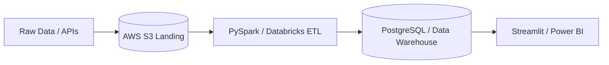

<!-- En README.md (Inglés) -->

  🌐 <b>English</b> | <a href="README.es.md">Español</a>

  

## Hi, I'm Diego Eraso 👋

  

---

Hi, I'm an Electronic Engineer and Data Specialist focused on transforming raw, complex data into scalable production pipelines, predictive models, and functional web applications. I am a strong advocate for the integration of technology and humanity—throughout history, innovation has consistently elevated our quality of life, from automating industrial labor to connecting global knowledge in seconds.

Today, breakthroughs in artificial intelligence driven by neural networks and transformers give us an unprecedented opportunity to delegate repetitive, memory-heavy tasks and focus on what makes us uniquely human: intuition and creativity. Instead of spending days or weeks building prototypes from scratch, we can use AI as a co-builder to rapidly validate hypotheses, test ideas, and expand the reach of what we can create.

---

### 🚧 What I'm Building

- **🛒 Smart Basket (*Canasta Inteligente*)** - A grocery price comparison platform powered by an AI assistant that translates real user needs into structured product requirements, generates shopping lists, and identifies the best stores to buy the complete basket.
- **📉 Dynamic Price & Seasonal Tracker** - A monitoring system for custom product lists that triggers real-time alerts when individual items or total basket costs drop, while also detecting seasonal trends and store inventory surpluses.
- **☁️ Cloud-Native Data & Web Architectures (AWS)** - Designing and deploying scalable, serverless, and containerized applications on AWS—integrating automated ETL pipelines, cloud storage, and API-driven backends.
- **🎓 Data Analytics & Data Science Learning Platform** - An interactive educational website designed to teach practical data analytics, machine learning workflows, and end-to-end project building.
- **🧭 Opportunity & Career Radar** - A web-scraping and AI-matching tool that aggregates job openings, volunteering roles, and community projects, filtering and ranking future opportunities based on the user's skills, knowledge level, and available free time.

---

### 🛠️ Tech Stack

  

---

  

